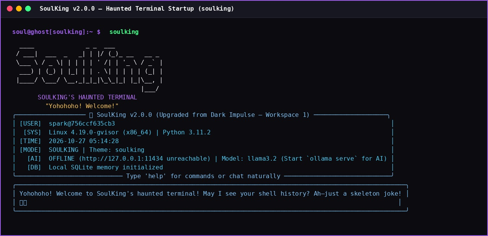
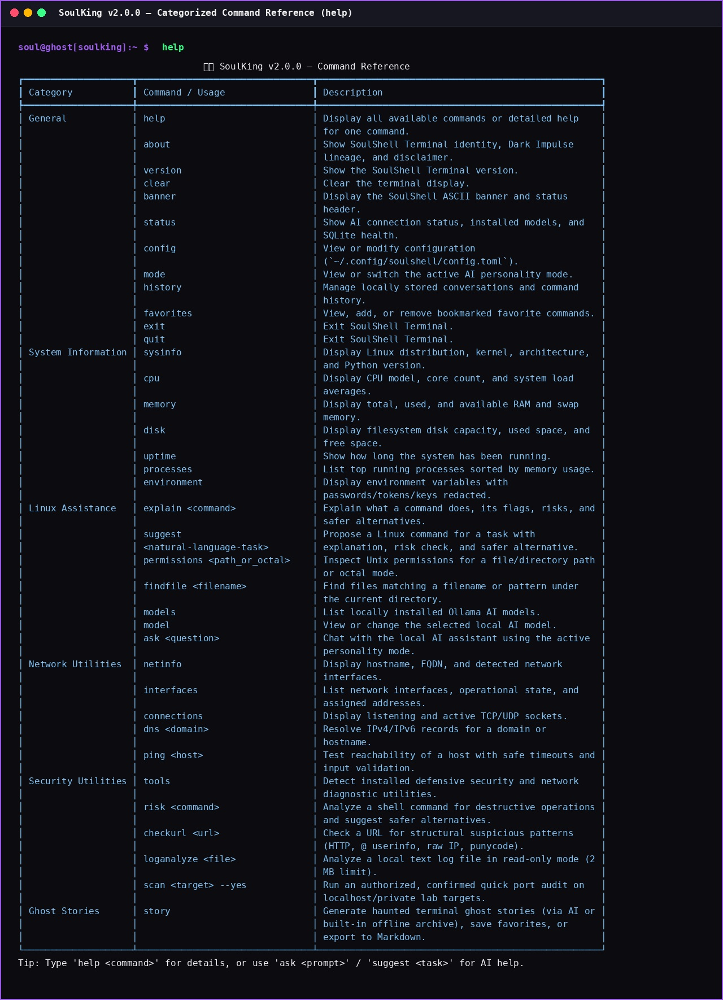
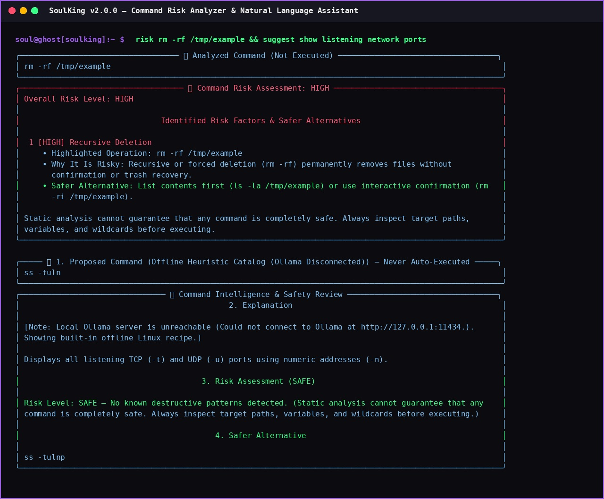
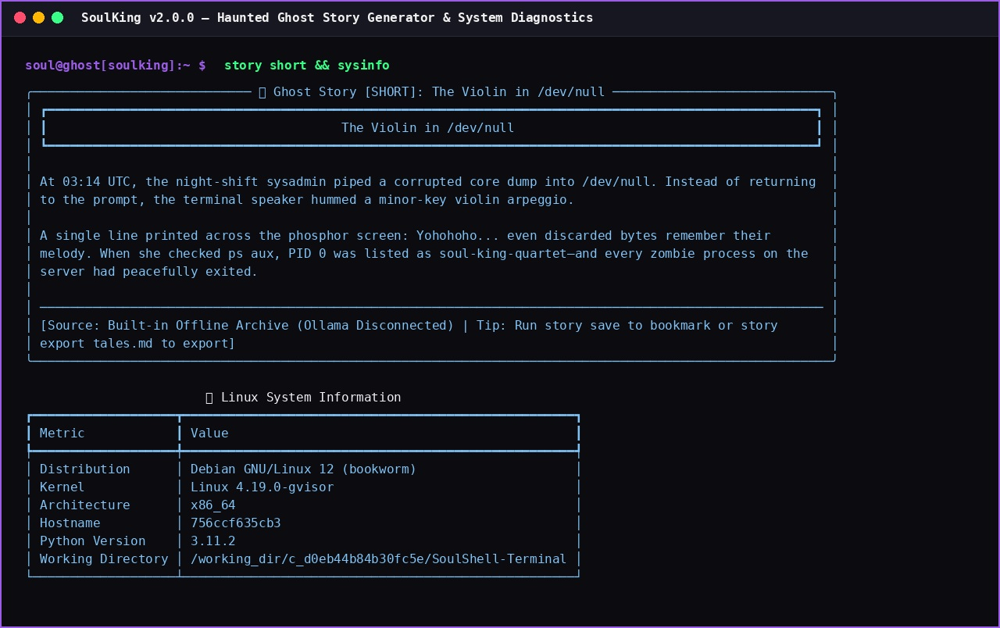

# 💀🎸 SoulKing — The Haunted AI-Powered Linux Terminal Assistant

> **Upgraded from:** *Dark Impulse — Workspace 1*  
> **Tagline:** *"Your terminal. Your AI. Your phantom."*  
> **Secondary Tagline:** *"Even without a body, intelligence lives on. Yohohoho!"*

## 1. Project Overview

**SoulKing** (`v2.0.0`) is a **100% terminal-based Linux CLI assistant** built with Python 3.11+, **Rich**, **SQLite**, and the local **Ollama HTTP API**. Designed for Kali Linux and other Linux distributions, it upgrades the original *Dark Impulse — Workspace 1* toolkit into an interactive, haunted command-line companion inspired by the skeleton musician and Soul King aesthetic.

There is **no GUI, desktop window, or browser interface**—the terminal itself is the entire experience. Every local utility, system/network inspector, command risk analyzer, SQLite history manager, and built-in ghost story works completely offline even when Ollama is not running.

## 2. Terminal Screenshots Showcase

All screenshots below are stored in the repository's [`screenshots/`](screenshots/) directory so they render automatically on GitHub:

### Haunted Terminal Startup & SOULKING Banner (`screenshots/s1.jpg`)


### Categorized Command Reference (`screenshots/s2.jpg`)


### Command Risk Analyzer & Natural-Language Linux Assistant (`screenshots/s3.jpg`)


### Haunted Ghost Story Generator & System Information (`screenshots/s4.jpg`)


## 3. Features

* **Haunted Terminal Startup Experience**: Displays the `SOULKING` ASCII banner and skeleton-musician artwork (`assets/banner.txt`), optional startup animation (`--no-anim` / `animations = false`), `user@hostname`, OS & Python version, current timestamp, live Ollama connection & model status, SQLite memory health, a Soul King greeting, and an interactive `soul@ghost[soulking]:~ $` prompt.
* **Three Selectable AI Personality Modes (`mode`)**:
  * `mode soulking` — Friendly, humorous, theatrical skeleton-musician spirit with musical metaphors and helpful explanations.
  * `mode developer` — Focused senior engineering persona for Python, Java, Linux, Git, debugging, and safer command alternatives.
  * `mode ghost` — Mysterious, spooky responses and atmospheric terminal guidance.
* **Local Ollama AI Integration**: Configurable base URL (`http://127.0.0.1:11434`), automatic server availability detection, installed model discovery (`models`), dynamic model switching (`model <name>`), streaming chat (`ask <question>`), conversation context, and honest offline fallback behavior.
* **System Information Suite**: `sysinfo`, `cpu`, `memory`, `disk`, `uptime`, `processes`, and `environment` (with automatic secret redaction for passwords, tokens, keys, and credentials).
* **Linux Command Assistance**:
  * `explain <command>` — Explains command behavior, flags, risks, and safer alternatives.
  * `suggest <natural-language-task>` — Proposes a syntax-highlighted shell command, explanation, risk assessment, and safer alternative without ever executing AI-generated commands automatically.
  * `permissions <path_or_octal>` — Read-only (`os.lstat`) permission breakdown for paths or octal strings (`755`, `0644`, `4755`).
  * `findfile <filename>` — Fast, safe recursive file locator.
* **Network Utilities**: `netinfo`, `interfaces`, `connections`, `dns <domain>`, and `ping <host>` with input validation and bounded timeouts.
* **Defensive Security Utilities & Command Risk Analyzer**:
  * `tools` — Detects installed security and networking utilities (`nmap`, `ss`, `ip`, `ufw`, `tcpdump`, `wireshark`, `fail2ban-client`, `lynis`, `rkhunter`, `clamscan`, `auditctl`, `openssl`, `gpg`, etc.).
  * `risk <command>` — Conservative `shlex`-based static analyzer flagging recursive deletion (`rm -rf`), disk formatting (`mkfs`, `dd`), destructive file overwrites (`> /etc/...`), privilege escalation (`sudo`, `chmod +s`), remote script execution pipelines (`curl ... | sh`), dangerous permission changes (`chmod 777`), secret exposure (`/etc/shadow`, `.env`), and compound shell operators (`;`, `&&`, `||`, `|`, `$()`), offering concrete safer alternatives.
  * `checkurl <url>` — Heuristic URL pattern checker (cleartext HTTP, `@` userinfo phishing syntax, raw IP hosts, punycode `xn--`, executable paths).
  * `loganalyze <file>` — Read-only log analyzer with a 2 MB safety cap, timestamp span detection, error/warning/auth-failure counters, and defensive triage steps.
  * `scan <target> --yes` — Preserved and safeguarded Nmap quick audit restricted to authorized loopback/private lab targets with explicit `--yes` confirmation.
* **Ghost Story Generator (`story`)**: Supports `story`, `story short`, `story cyberpunk`, `story mystery`, `story random`, `story save`, `story list`, and `story export <file.md>`, using local AI when online or built-in haunted terminal stories when offline.
* **Local SQLite Memory & TOML Configuration**: Stores conversations, messages, favorite commands (`favorites`), saved stories, and preferences in `~/.local/share/soulking/soulking.db`, paired with human-readable configuration in `~/.config/soulking/config.toml`.

## 4. Terminal Startup & ASCII Banner

```text
   ███████╗ ██████╗ ██╗   ██╗██╗     ██╗  ██╗██╗███╗   ██╗ ██████╗ 
   ██╔════╝██╔═══██╗██║   ██║██║     ██║ ██╔╝██║████╗  ██║██╔════╝ 
   ███████╗██║   ██║██║   ██║██║     █████╔╝ ██║██╔██╗ ██║██║  ███╗
   ╚════██║██║   ██║██║   ██║██║     ██╔═██╗ ██║██║╚██╗██║██║   ██║
   ███████║╚██████╔╝╚██████╔╝███████╗██║  ██╗██║██║ ╚████║╚██████╔╝
   ╚══════╝ ╚═════╝  ╚═════╝ ╚══════╝╚═╝  ╚═╝╚═╝╚═╝  ╚═══╝ ╚═════╝ 
                    ♪ ♫  SOULKING'S HAUNTED TERMINAL  ♫ ♪
                         "Yohohoho! Welcome, traveler!"

╭────── 💀 SoulKing v2.0.0 (Upgraded from Dark Impulse — Workspace 1) ───────╮
│ [USER]  kali@ghost                                                         │
│  [SYS]  Linux 6.6.15-amd64 (x86_64) | Python 3.11.2                        │
│ [TIME]  2026-10-27 10:42:00                                                │
│ [MODE]  SOULKING | Theme: soulking                                         │
│   [AI]  ONLINE (http://127.0.0.1:11434) | Model: llama3.2 (Ready)          │
│   [DB]  Local SQLite memory initialized                                    │
╰─────────────── Type 'help' for commands or chat naturally ─────────────────╯

soul@ghost[soulking]:~ $ risk rm -rf /tmp/example
```

## 5. Requirements & Python Version

* **Operating System**: Kali Linux, Debian, Ubuntu, Fedora, Arch Linux, or any POSIX-compatible Linux distribution.
* **Python Version**: **Python 3.11** or newer.
* **Core Python Packages** (`requirements.txt` — 100% terminal-only):
  * `rich>=13.0.0`
  * `httpx>=0.23.0`
  * `Pygments>=2.15.0`
  * `python-dotenv>=1.0.0`
* **Optional Test Runner**: `pytest>=7.4.0` (standard library `unittest` is also supported out of the box).

## 6. Installation Instructions (Kali Linux & Other Linux Distributions)

```bash
# 1. Clone the repository and enter the directory
git clone https://github.com/<your-username>/SoulKing.git
cd SoulKing

# 2. On Kali / Debian / Ubuntu, ensure python3-venv is installed
sudo apt update && sudo apt install -y python3-venv

# 3. Create and activate a virtual environment
python3 -m venv .venv
source .venv/bin/activate

# 4. Upgrade pip and install SoulKing in editable mode
python -m pip install --upgrade pip
python -m pip install -e .
```

## 7. Ollama Installation & Local Model Setup

SoulKing works offline for all system, network, security, and built-in story commands even without Ollama. To enable local AI generation:

1. **Install Ollama** on Linux:
   ```bash
   curl -fsSL https://ollama.com/install.sh | sh
   ```
   *(Tip: Always inspect downloaded scripts before running—or download the official binary package from <https://ollama.com/download>.)*
2. **Start the local Ollama service**:
   ```bash
   ollama serve
   ```
3. **Download a local open-weight model**:
   ```bash
   # Lightweight 3B model (~2.0 GB) — great for laptops and VMs
   ollama pull llama3.2

   # Or a 7B coding/Linux specialist (~4.7 GB)
   ollama pull qwen2.5-coder:7b
   ```
4. **Select the model inside SoulKing**:
   ```bash
   soulking -c "model llama3.2"
   ```

## 8. How to Launch the Program

```bash
# Launch interactive haunted REPL (after `pip install -e .`)
soulking

# Or launch directly from the repository root
python3 main.py

# Launch without startup animation or in plain non-Unicode mode
python3 main.py --no-anim
python3 main.py --plain

# Execute a single command directly from your system shell
python3 main.py status
python3 main.py -c "risk rm -rf /tmp/example"
python3 main.py -c "suggest find Python files modified in the last seven days"
```

## 9. Complete Command Reference

| Category | Command | Description |
| :--- | :--- | :--- |
| **General** | `help [command]` | Display all commands or detailed usage for a specific command. |
| **General** | `about` | Show project identity, *Dark Impulse* lineage, and disclaimers. |
| **General** | `version` | Display the SoulKing version (`v2.0.0`). |
| **General** | `clear` | Clear the terminal display. |
| **General** | `banner` | Render the SOULKING ASCII banner and status summary. |
| **General** | `status` | Show live Ollama connection status, installed models, and SQLite health. |
| **General** | `config [show\|set <k> <v>\|path\|reset --yes]` | View or update `~/.config/soulking/config.toml`. |
| **General** | `mode [soulking\|developer\|ghost]` | View or switch the active AI personality mode. |
| **General** | `history [list\|search <q>\|view <id>\|export <f>\|clear --yes]` | View, search, export, or delete local SQLite history. |
| **General** | `favorites [list\|add <cmd>\|remove <id> --yes]` | Bookmark, list, or delete favorite shell commands. |
| **General** | `exit` / `quit` | Exit SoulKing gracefully. |
| **System Info** | `sysinfo` | Show OS distribution, kernel, architecture, hostname, and Python version. |
| **System Info** | `cpu` | Show CPU model, logical core count, and 1m/5m/15m load averages. |
| **System Info** | `memory` | Show total, used, and available RAM and swap memory. |
| **System Info** | `disk [path]` | Show total, used, and free disk capacity (default `/`). |
| **System Info** | `uptime` | Show system uptime in days, hours, minutes, and seconds. |
| **System Info** | `processes` | List top running processes sorted by memory usage. |
| **System Info** | `environment [filter]` | Display environment variables with secrets (`KEY`, `TOKEN`, `PASS`, `SECRET`) redacted. |
| **Linux Help** | `explain <command>` | Explain what a Linux command does, its flags, risks, and safer alternatives. |
| **Linux Help** | `suggest <natural-language-task>` | Propose a command, explanation, risk assessment, and safer alternative (never auto-executes). |
| **Linux Help** | `permissions <path_or_octal>` | Inspect Unix permissions for a path (`~/Documents`) or octal mode (`755`). |
| **Linux Help** | `findfile <filename>` | Search for files matching a filename or pattern under the current directory. |
| **Linux Help** | `models` / `model [name]` | List installed Ollama models or switch the active model. |
| **Linux Help** | `ask <question>` | Chat with the local AI assistant in the active personality mode. |
| **Network** | `netinfo` | Display hostname, FQDN, and detected network interfaces. |
| **Network** | `interfaces` | List network interfaces, operational state, and assigned IP addresses. |
| **Network** | `connections` | List listening and active TCP/UDP sockets (`ss -tuln` / `/proc/net/tcp`). |
| **Network** | `dns <domain>` | Resolve IPv4 and IPv6 records for a domain or hostname. |
| **Network** | `ping <host>` | Check host reachability with safe input validation and bounded timeouts. |
| **Security** | `tools` | Detect installed defensive security and networking tools on the system. |
| **Security** | `risk <command>` | Parse a shell command for destructive operations, operators, and safer alternatives. |
| **Security** | `checkurl <url>` | Inspect a URL for suspicious structural patterns without claiming site safety proof. |
| **Security** | `loganalyze <file>` | Analyze a local text log file in read-only mode (2 MB limit). |
| **Security** | `scan <target> --yes` | Run an authorized, confirmed quick Nmap port audit on `localhost`/private lab IPs. |
| **Ghost Stories** | `story [short\|cyberpunk\|mystery\|random\|save\|list\|export <file.md>]` | Generate AI or built-in offline haunted stories, save favorites, or export to Markdown. |

## 10. Configuration Details (`~/.config/soulking/config.toml`)

SoulKing reads and writes `~/.config/soulking/config.toml` automatically:

```toml
assistant_name = "SoulKing"
theme = "soulking"  # Options: soulking, cyberpunk, phantom, plain
personality_mode = "soulking"  # Options: soulking, developer, ghost
model = "llama3.2"
ollama_url = "http://127.0.0.1:11434"
animations = true
save_history = true
request_timeout = 60
log_level = "INFO"  # Options: DEBUG, INFO, WARNING, ERROR
humor_frequency = "balanced"  # Options: minimal, balanced, frequent
explanation_level = "intermediate"  # Options: beginner, intermediate, advanced
temperature = 0.7
```

Modify settings interactively at any time:
```bash
soul@ghost[soulking]:~ $ config set model qwen2.5-coder:7b
soul@ghost[soulking]:~ $ config set save_history false
```

## 11. Database & Privacy Information

* **Database Location**: `~/.local/share/soulking/soulking.db` (overridable via `SOULKING_DATA_DIR`).
* **Stored Tables**: `conversations`, `messages`, `command_history`, `favorite_commands`, `saved_ghost_items`, and `user_settings`.
* **Privacy Mode**: Setting `config set save_history false` stops conversations and command history from being written to SQLite.
* **Zero External Telemetry**: All prompts, history, and AI requests stay 100% local by default.
* **Safe Deletion**: Deleting conversations (`history clear --yes`) or favorites (`favorites remove <id> --yes`) requires explicit confirmation.

## 12. Troubleshooting

* **Ollama is not installed or not running**:
  * `status` will show `OFFLINE`. Install Ollama and run `ollama serve`. All non-AI commands (`sysinfo`, `risk`, `permissions`, `netinfo`, `tools`, `loganalyze`, and built-in `story` / `suggest` / `explain` fallbacks) continue to work offline.
* **Selected model not found**:
  * Run `models` to see installed models, pull the desired model via `ollama pull llama3.2`, or switch with `model <installed_name>`.
* **Terminal lacks Unicode or color support**:
  * Launch with `python3 main.py --plain` or run `config set theme plain`.

## 13. Testing Instructions

Run the automated test suite using `pytest` or `unittest` (all Ollama calls are mocked so no running AI server or internet connection is required):

```bash
# Using standard library unittest
PYTHONPATH=src python3 -m unittest discover -s tests -p "test_*.py" -v

# Or using pytest
pytest
```

## 14. Security Limitations

* **Static Command Risk Analysis**: `risk <command>` parses shell tokens and operators conservatively, but **static analysis cannot guarantee that any command is completely safe**. Always review paths and arguments before executing commands in your shell.
* **Heuristic URL Checks**: `checkurl <url>` inspects URL syntax only; it does not query external threat-intelligence feeds or prove that a destination site is benign.
* **Never Auto-Executes AI Output**: `suggest` and `explain` never execute commands automatically.

## 15. Contribution Guidelines & License

1. Fork the repository and create a feature branch.
2. Keep the application 100% terminal-based (`rich` + standard library) without introducing GUI or browser dependencies.
3. Ensure all unit tests pass before opening a pull request.
4. Released under the **MIT License** (see `LICENSE`). This is an unofficial fan-inspired open-source project and is not affiliated with *One Piece*'s rights holders.
